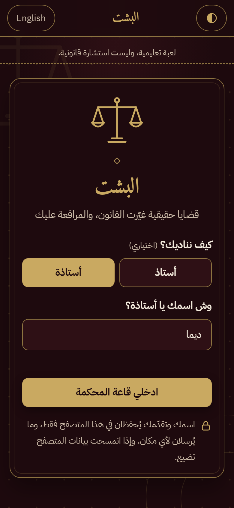
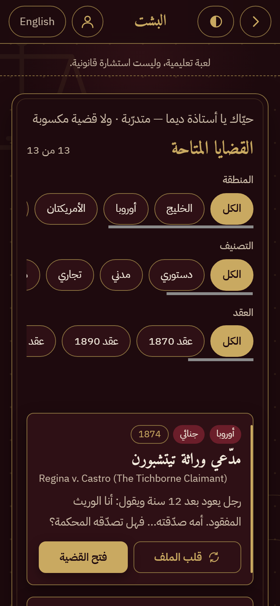
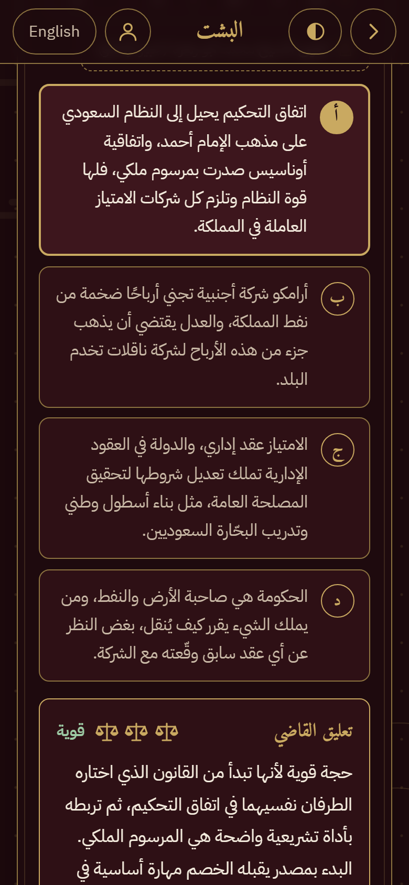
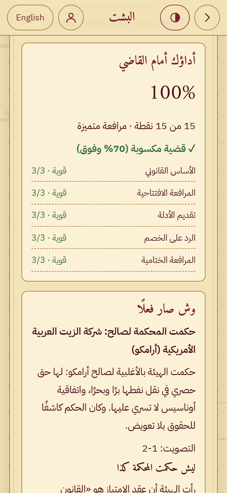
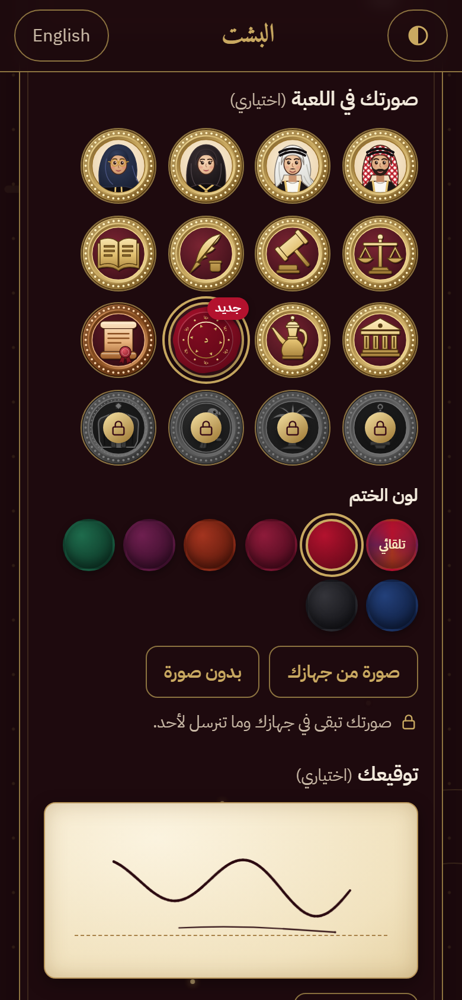
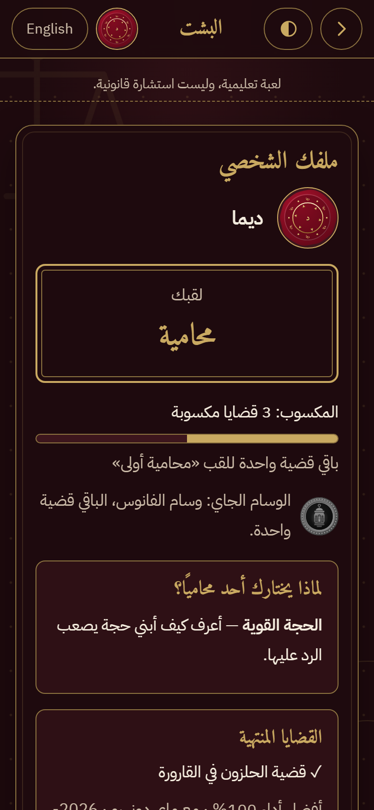
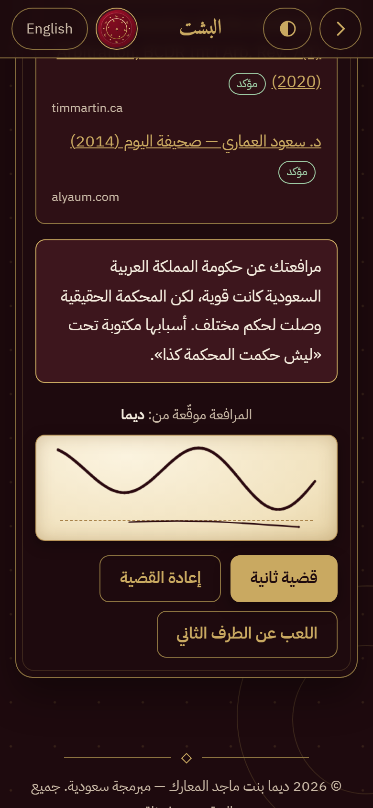

# البشت — Al-Bisht

**[العربية](#العربية) · [English](#english)**

---

## العربية

### وش هي اللعبة؟
«البشت» لعبة ويب تعليمية لعمر 13 سنة وفوق. تترافع فيها في قضايا حقيقية من دول وسنوات مختلفة، وتختار من حجج وأدلة جاهزة، والقاضي يقيّم كل اختيار ويشرح ليش. وفي النهاية تشوف «وش صار فعلًا» في المحكمة الحقيقية.

- كل قضية تنلعب من الطرفين، والنقاط تقيس جودة الحجة، مو اتجاه الحكم.
- خمس مراحل: الأساس القانوني، المرافعة الافتتاحية، تقديم الأدلة، الرد على الخصم، المرافعة الختامية.
- لقب يكبر مع القضايا المكسوبة (أداء 70% وفوق): متدرّب ← محامٍ ← محامٍ أول ← مستشار ← كبير المستشارين ← أسطورة المرافعة.
- **وسام مع كل لقب:** الرَّق المختوم (برونزي) ← الفانوس (فضي) ← النخلة (ذهبي) ← الصقر (زمرّدي) ← البشت الملكي. الوسام يبقى مقفل لين توصل لقبه.
- **صورتك في اللعبة:** 4 وجوه سعودية، و6 أوسمة، وصورة من جهازك (تقدر تحرّكها وتقرّبها)، أو **ختمك الشخصي**: ختم شمع يتولّد من اسمك وتختار لونه.
- **توقيعك:** توقّع بإصبعك أو بالماوس، ويطلع توقيعك تحت كل مرافعة في صفحة النتيجة.
- عربي أولًا، وزر يحوّل الواجهة للإنجليزي. وفيه زر «قلب الألوان» (خمري أو ذهبي).
- بدون تسجيل وبدون خادم: التقدّم والصورة والتوقيع تُحفظ في متصفحك فقط، وما تُرسل لأي مكان.

**ليش «البشت»؟** البشت في السعودية رمز الوجاهة، وهو زي المرافعة في المحاكم. واللعبة تستخدمه رمزًا لهيبة الحجة، للمحامين والمحاميات على حد سواء.

> لعبة تعليمية، وليست استشارة قانونية.

<p align="center">
  
  
  
  
</p>
<p align="center">
  
  
  
</p>

### كيف تشغّلها؟
- **أسهل طريقة:** افتح الملف `index.html` بالمتصفح (نقرتين). تشتغل من الجهاز مباشرة بدون إنترنت، ما عدا الخطوط اللي تنزل من Google Fonts (وبدونها يظهر خط النظام).
- **أو من خادم محلي:**
  ```
  python -m http.server 8000
  ```
  ثم افتح `http://localhost:8000`.

### أدوات الفحص (Node.js، بدون أي حزم)
```
node scripts/validate-cases.mjs          # يفحص كل ملفات القضايا حسب docs/case-format.md
node scripts/validate-cases.mjs <مجلد>   # يفحص مجلد ثاني (للتجربة)
node scripts/test-logic.mjs              # يختبر التقييم والألقاب والفلاتر والتخزين ونصوص الواجهة
```
السكربت الأول يرجع exit code 1 عند أي خطأ. التحذيرات (مثل طول النص) ما تفشّل الفحص.

### كيف تضيف قضية؟
1. اقرأ `docs/case-format.md` (الصيغة الملزمة).
2. أنشئ ملف `data/cases/<id>.js`، واسم الملف نفس `id`، مثل `data/cases/tinker-1969.js`.
3. أضف سطرها في `index.html` داخل قسم القضايا:
   ```html
   <script src="data/cases/tinker-1969.js" onerror="CASE_LOAD_ERRORS.push(this.getAttribute('src'))"></script>
   ```
4. شغّل `node scripts/validate-cases.mjs` وتأكد إنه ينجح.
5. القضية ما تظهر في اللعبة إلا إذا كان `review: "reviewed"`.

### الإعدادات
كل النصوص والإعدادات في مكان واحد: كائن `CONFIG` داخل `index.html`. وفيه نصوص الواجهة بلغتين، والألقاب وحدودها، وحدّ القضية المكسوبة (70%)، ودرجات التقييم، وأرقام الحركة.

### هيكل المشروع
```
index.html                 الواجهة كاملة + CSS + JavaScript + CONFIG
data/cases/<id>.js         ملف لكل قضية
scripts/validate-cases.mjs فحص ملفات القضايا
scripts/test-logic.mjs     اختبارات المنطق
docs/                      القرارات والخطة والتصميم وتقارير البحث
LICENSE                    جميع الحقوق محفوظة
```

### الحقوق
© 2026 **ديما بنت ماجد المعارك**، مبرمجة سعودية. جميع الحقوق محفوظة.

«البشت» مشروع شخصي من تطوير ديما المعارك. لا يجوز نسخه أو تعديله أو إعادة نشره أو بيعه، كليًا أو جزئيًا، دون إذن كتابي مسبق منها. التفاصيل في ملف [LICENSE](LICENSE).

ملخصات القضايا مبنية على سجلات محاكم ومصادر منشورة، ومذكور مع كل مصدر حالة التحقق منه. والحوارات والخيارات مُعدّة لأغراض تعليمية.

---

## English

### What is it?
**Al-Bisht** is an educational web game for ages 13 and up. You argue real cases from different countries and eras by choosing from prepared arguments and evidence. A judge rates every choice and explains why. At the end you see what really happened in court.

- Every case can be played from both sides. Points measure the quality of the argument, not which side won.
- Five stages: legal basis, opening statement, evidence, rebuttal, closing argument.
- Your title grows with the cases you win (70% or higher): Trainee → Lawyer → Senior Lawyer → Counsel → Chief Counsel → Legend of Advocacy.
- **A medal for every title:** Sealed Scroll (bronze) → Lantern (silver) → Palm (gold) → Falcon (emerald) → Royal Bisht. Each medal stays locked until you reach its title.
- **Your avatar:** 4 Saudi faces, 6 medals, a photo from your device (drag and zoom to fit), or **your personal seal**: a wax seal generated from your name, in the colour you choose.
- **Your signature:** sign with your finger or mouse, and it appears under every pleading on the result screen.
- Arabic first, with a button that switches the interface to English. A "Flip colors" button switches between the wine and gold themes.
- No sign-up and no server. Progress, photo and signature are stored only in your browser and are never sent anywhere.

**Why "Al-Bisht"?** The bisht is a traditional Saudi cloak that stands for dignity and honor, and it is worn when arguing in Saudi courts. The game uses it as a symbol of a well-argued case, for every player.

> An educational game, not legal advice.

<p align="center">
  
  
  
  
</p>
<p align="center">
  
  
  
</p>

### How to run it
- **Easiest:** double-click `index.html`. It runs locally without internet. Only the fonts come from Google Fonts; without them the system font is used.
- **Or with a local server:**
  ```
  python -m http.server 8000
  ```
  Then open `http://localhost:8000`.

### Checks (Node.js, no packages)
```
node scripts/validate-cases.mjs          # validates every case file against docs/case-format.md
node scripts/validate-cases.mjs <folder> # validates another folder (for testing)
node scripts/test-logic.mjs              # tests scoring, titles, filters, storage and UI strings
```
The validator exits with code 1 on any error. Warnings (such as text length) do not fail the check.

### How to add a case
1. Read `docs/case-format.md` (the required format).
2. Create `data/cases/<id>.js`. The file name must match the `id`.
3. Add a `<script src="data/cases/<id>.js" onerror="...">` line in the cases section of `index.html`.
4. Run `node scripts/validate-cases.mjs` and make sure it passes.
5. A case only appears in the game when it has `review: "reviewed"`.

### Settings
All texts and settings are in one place: the `CONFIG` object inside `index.html`. It holds the UI strings in both languages, the titles and their thresholds, the win threshold (70%), the rating bands and the animation timings.

### Copyright
© 2026 **Deema Majid AlMaarik** (ديما بنت ماجد المعارك), Saudi programmer. All rights reserved.

Al-Bisht is a personal project developed by Deema AlMaarik. It may not be copied, modified, redistributed or sold, in whole or in part, without her prior written permission. See [LICENSE](LICENSE).

Case summaries are based on public court records and cited sources, and each source shows its verification status. Dialogue and choices are written for educational purposes.
